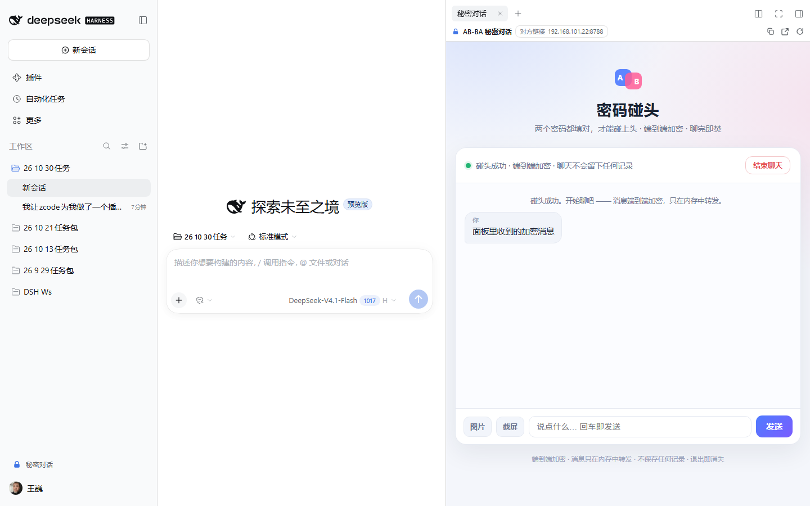
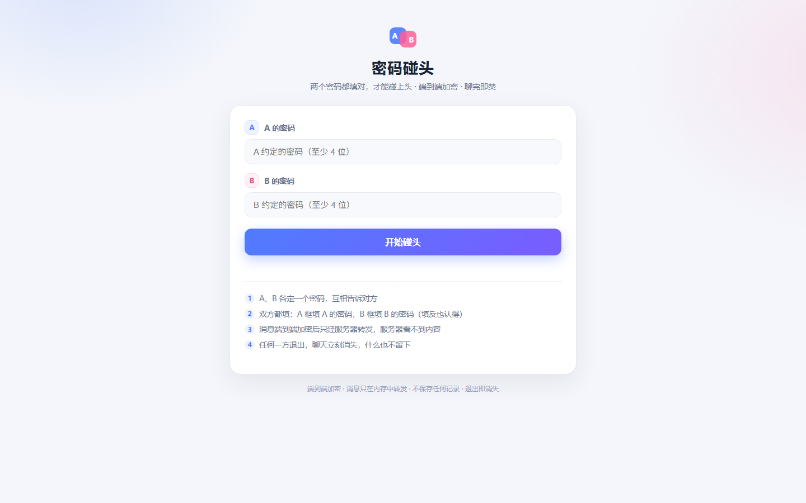
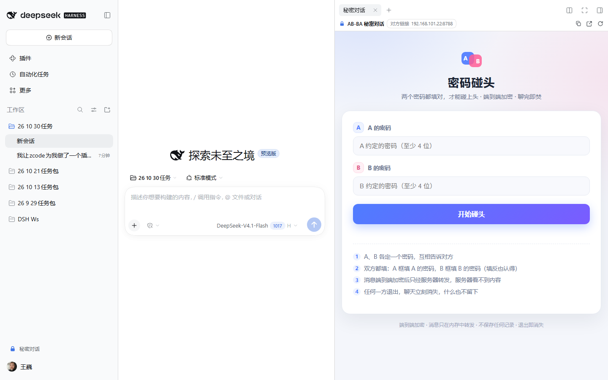

# AB-BA Secret Chat · dsh-abba-secret-chat

A one-off, two-person password chat that docks in the **DeepSeek Harness** right sidebar. A and B each set a password and tell each other; **both must match** to pair. It is **end-to-end encrypted** — messages and images are encrypted in your browsers, so the server (and anyone sniffing the network) sees only ciphertext, and **only someone who knows both passwords can read them**. Nothing is stored or logged, and **everything disappears when DSH exits**.

English | [中文](README.zh.md)



*A “Secret chat” entry appears at the bottom of the left sidebar; the chat opens in the right sidebar next to your main conversation, which keeps working untouched.*

## What it solves

Sometimes you want to say a few private things to someone nearby (a colleague, family member, a friend) without creating accounts, leaving chat history behind, or mixing it into your AI session. Two people each know a password, one click opens a room that only exists while both are in it — and burns after use.

## Features

- **Sidebar chat** — a **🔒 Secret chat** button at the bottom of the left sidebar (icon-only when narrow) opens a “Secret chat” tab in the **right sidebar**; the chat page is embedded in that tab. It can also be opened from the right sidebar’s “+” page. Your main conversation is unaffected.
- **End-to-end encryption** — both passwords stay in the browser and only drive key derivation (SHA-256 → PBKDF2-HMAC-SHA256 → AES-256-CBC with HMAC-SHA256 integrity). The server receives a pairing hash and ciphertext only: no passwords, no readable content. Packet capture on the same Wi-Fi sees ciphertext too.
- **Two-password pairing** — the A field takes A’s password and the B field takes B’s password; only when both are correct do two people meet. **Swapping the fields still works** (the pairing key is order-independent).
- **Two people per combination** — a third person using the same pair is rejected. If either side leaves, refreshes, or disconnects, the room is destroyed and both sides are cleared immediately.
- **Images and screenshots** — pick, paste, or drag an image, or click **Screenshot** to capture what is currently visible on screen. Both are compressed, encrypted, and sent; the peer can open them full-size. Screen capture inside the DSH right sidebar needs the host to allow it; when denied the page tells you to use “Open in browser”. (Browsers only expose screen capture on a secure origin, so a LAN guest on plain `http://192.168.x.x` gets a hint instead.)
- **“Me / You” labels** — no names are shown anywhere; each bubble is labelled 「我」 (me) or 「你」 (you) from your own point of view.
- **Full cleanup on end** — keys are dropped, messages and images are removed, the live connection is closed; the server destroys the room and its queues at the same time. The page uses no cookies, localStorage, sessionStorage, or IndexedDB.
- **Works on your LAN** — a tiny zero-dependency HTTP service on `8787` (falls back `+1…+9`, then OS-assigned) lets the other person join from a browser on the same Wi-Fi with **nothing installed**.
- **Zero runtime dependencies, no build step** — no npm runtime dependencies, no `postinstall`. crypto-js is vendored in-tree under MIT (see `THIRD_PARTY_NOTICES.md`). MIT.
- **Tied to DSH’s lifecycle** — the chat service lives inside the DSH process and closes when DSH exits or the plugin unloads. No resident background process.

## Install

Requires **DeepSeek Harness `>= 0.2.1-rc.3`** (`engines.dsh`; earlier hosts lack the right sidebar and the `sidebarRight` API). The current version is fully tested on **0.2.1-rc.5**.

**A. From the market (once listed)**

DSH → left sidebar **Plugins** → **Market** → search `dsh-abba-secret-chat` → Install.

**B. From a local directory (desktop)**

DSH desktop → left sidebar **Plugins** → **Install** → **local directory** → point at this package → Install, then **fully quit and reopen DSH**.

**C. Command line (plain `dsh web` or a custom profile)**

```powershell
dsh plugin --profile web add dsh-abba-secret-chat
# or install from source:
dsh plugin --profile web add github:v93013520/dsh-abba-secret-chat
```

> The desktop profile is owned by the desktop app’s plugin manager — install through the in-app Plugins page instead of editing `profiles/desktop` by hand.

Restart DSH after installing or updating so the new plugin loads.

## Three-step usage

1. **Agree on passwords** — A and B each pick a password (4–128 chars) and tell each other **out of band**. Those two passwords are the only secret: they pair the room and unlock decryption.
2. **Both join** — A clicks **Secret chat** in the left sidebar, fills A’s password in the A field and B’s password in the B field, clicks **Start**, and waits. B opens the **peer link** shown in the panel toolbar (`http://192.168.x.x:8787`) in a browser on the same Wi-Fi and joins with the same two passwords (swapped is fine) — the two are paired automatically.
3. **Chat and end** — Enter or Send delivers in real time; **Image** picks/pastes/drops a picture, **Screenshot** captures the current screen. Either side clicking **End chat** (or closing/refreshing the page) destroys the room and clears both sides. A waiting initiator is cancelled after 10 minutes.

> Want to try alone? Open `http://127.0.0.1:8787` in two browser tabs on this machine — one as A, one as B.

## Screens

| Two-password start page | Right-sidebar panel (entry, peer link, image/screenshot) |
|---|---|
|  |  |

## Commands

Type these in the DSH composer:

| Command | Effect |
|---|---|
| `/abba` | Show status, local URL, LAN URL, and how to open the panel |
| `/abba status` | Same as above |
| `/abba stop` | Stop the chat service (the panel stops working) |
| `/abba 9000` | Restart on port 9000 (with the same port fallback) |

## Configuration (optional)

There is no settings UI; to change the port or restrict access to this machine, override the row’s `config` in your profile’s `cordis.patch.yml` (a patch replaces the row’s whole `config`):

```yaml
- id: abba-secret-chat
  name: dsh-abba-secret-chat
  config:
    port: 9000        # default 8787; falls back +1..+9 when busy
    host: 127.0.0.1   # default 0.0.0.0 (LAN reachable); set this for local-only
```

## Privacy and security

- **End-to-end encryption** — the two passwords only drive local derivation: `hA/hB = SHA256(password)`, sorted and hashed again into the pairing key sent to the server; the encryption key (`PBKDF2(hA|hB)`) and MAC key are derived separately and **never sent**. Messages use AES-256-CBC with a random IV plus HMAC-SHA256, verified before decryption. The server and network sniffers see only ciphertext and a pairing hash; reading content requires both passwords.
- **Memory only** — rooms, members, and ciphertext live in process memory; nothing is written to a database or file, and message content is never logged.
- **No browser storage** — the page uses no cookies, `localStorage`, `sessionStorage`, or IndexedDB.
- **Plain HTTP (content still encrypted)** — the page itself is served over plain HTTP on the LAN (default `0.0.0.0:8787`), but messages and images are application-layer encrypted, so captures show ciphertext. Use it on a trusted network; **anyone who knows both passwords can join**.
- **Isolated from your DSH session** — the chat page is a separate web page; its content never enters DSH session history or the model. The plugin registers no model-facing tools.
- **Lifecycle** — the service starts and stops with the DSH process; no resident background process or system service.

## Compatibility

| Host | Notes |
|---|---|
| DSH Desktop `>= 0.2.1-rc.5` | Fully tested (right-sidebar tab, entry, encrypted chat in the panel, images, `/abba`) |
| DSH `0.2.1-rc.3`–`rc.4` | Satisfies `engines.dsh`; UI and service are host-version agnostic, but prefer the current release |
| `dsh web` (same version) | Same right sidebar and entry |
| Older hosts (no right sidebar) | `engines.dsh` not satisfied; the entry degrades to opening the chat page in a browser tab |

## Development and tests

```powershell
# Crypto layer: vectors, round-trip, tampering/wrong password, interop with Node crypto, perf (431 checks)
node test/crypto-unit.mjs

# Server protocol v2: pairKey pairing/swapped/third-person/bad payload/cleanup/port release
node test/host-e2e-v2.mjs

# Host plugin contract (/abba/info shape, port fallback, port release on stop, command surface, never throws)
node test/host-info.mjs

# Offline browser-half test (bundle protocol, slot registrations, rendering, fallbacks)
node test/client-harness.mjs

# Page static checks (no plaintext requests, no browser storage, me/you labels, image/screenshot/cleanup logic)
node test/ui-static.mjs

# Real-browser acceptance (headless Edge + CDP): encrypted two-person flow, images, no plaintext on the wire,
# encrypted chat inside the DSH panel, screenshots
node test/browser-e2e.mjs --dsh "http://127.0.0.1:3095/?token=<token>" --out docs/screenshots
```

Layout:

```
lib/index.js            host plugin entry (server lifecycle, /abba/info route, /abba command)
lib/server.js           chat service (zero deps; pairKey pairing, ciphertext relay, full cleanup)
lib/lan.js              LAN address enumeration
assets/index.html       chat page (encryption, images, screenshot, me/you labels, end cleanup)
assets/abba-crypto.js   crypto wrapper (derive keys / encrypt / verify-then-decrypt)
assets/crypto-js.min.js vendored crypto-js 4.2.0 (MIT, see THIRD_PARTY_NOTICES.md)
client/client.js        browser half: right-sidebar tab + entry button + no-session overlay (hand-written bundle, no build)
cordis.patch.yml        the plugin row (single dual-face package)
```

## License

MIT © wangwei
